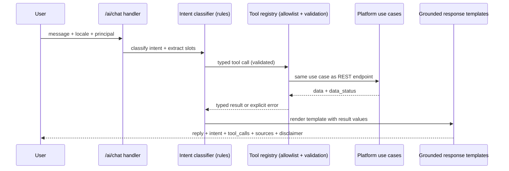

# BozorPulse — AI Specifications

> Part of the current spec. See [README.md](../README.md), [ARCHITECTURE.md](ARCHITECTURE.md), [DATA-MODEL.md](DATA-MODEL.md), and [ROADMAP.md](ROADMAP.md). The legacy `overview.md` brief is superseded.

## 0. Principles

1. **Modest and honest.** The MVP has four AI-facing capabilities: market price statistics, deterministic supplier recommendations, an assistant backed by an LLM with a rule-based fallback, and a customer buying assistant ("what to buy / where to buy"). No demand prediction, no generative product claims. A conservative 30-day **price outlook** is exposed through the existing `price_forecast` tool and is also consumed by the customer **Planning** module; it is always labeled as an estimate with a range and uncertainty, never a quote.
2. **Deterministic by default.** Statistics and rankings are pure functions of database state. No randomness, no model call in the ranking path. Same data snapshot → same output.
3. **Grounded in platform data.** The assistant reaches data only through typed tools backed by the same use cases the REST API uses. It never invents numbers, suppliers, or prices.
4. **Labeled demo data.** Seed data is explicitly labeled in **both API responses and UI**. Nothing synthetic is presented as a real market quote ([§4](#4-demo-data-labeling-rules)).
5. **Runs without external services when needed.** With `AI_LLM_ENABLED=false` (or no `MODEL_API_KEY`) the rule-based assistant works with PostgreSQL only — no API key, no Redis, no LLM. With a key, the Meta Model API is used. There is still no Redis ([ADR-003](ARCHITECTURE.md#adr-003-no-redis-in-the-mvp)).

---

## 1. Market price statistics

**Endpoint:** `GET /api/v1/market/prices?category_id=<id>&q=<text>` (public). Implemented in the `ai` module using `price_samples` as the data source.

### 1.1 Response shape

```json
{
  "samples": [
    {
      "id": 41,
      "product_id": 12,
      "product_name": "Portland cement M400",
      "price": 3100,
      "unit": "bag",
      "region_id": 1,
      "captured_at": "2026-11-01T10:00:00Z",
      "is_demo": true
    }
  ],
  "stats": { "min": 2900, "median": 3100, "avg": 3125, "count": 12 },
  "data_status": "demo",
  "generated_at": "2026-11-17T09:30:00Z",
  "disclaimer": "Sample market data for demonstration. Not a live market quote."
}
```

Required fields: `samples`, `stats {min, median, avg, count}`, `data_status`. `generated_at` and `disclaimer` are additional metadata.

### 1.2 Sample selection

1. Start from `price_samples` where `captured_at >= now() - 90 days` and `price > 0`.
2. Apply `category_id` filter (sample's category, derived from its product) and `q` as a case-insensitive substring match on product `name` or `sku`.
3. Keep only samples whose product belongs to a **confirmed** supplier.
4. **Deduplicate:** keep the most recent sample per `product_id` in the window, so one heavily sampled product cannot dominate the statistics.
5. Result set is `S = [p₁ … pₙ]` (prices of the deduplicated samples).

### 1.3 Computation

| Statistic | Definition |
| --- | --- |
| `min` | `min(S)` |
| `median` | Middle element of sorted `S`; if `n` is even, arithmetic mean of the two middle elements. |
| `avg` | `sum(S) / n` |
| `count` | `n` (number of deduplicated samples) |

- All monetary outputs are `NUMERIC(14,2)`, rounded half-up to 2 decimals.
- `MIN_SAMPLES = 5`. If `n < MIN_SAMPLES`, return `data_status: "insufficient"`, `stats` with `null` for `min`/`median`/`avg` and the actual `count`, and an empty or partial `samples` array. **Do not extrapolate or fabricate values.**

### 1.4 `data_status` decision

| Value | Condition |
| --- | --- |
| `live` | `n >= MIN_SAMPLES` and all selected samples have `is_demo = false`. |
| `demo` | `n >= MIN_SAMPLES` and at least one selected sample has `is_demo = true`. |
| `insufficient` | `n < MIN_SAMPLES`. |

`count` is always the real number of samples used. The UI shows a sample-size badge ("based on N offers") next to every statistic.

---

## 2. Deterministic supplier recommendations

**Endpoint:** `GET /api/v1/ai/recommendations?product_id=<id>` (authenticated). Given a product, find suppliers offering the same category and rank them. For a customer, the region of their preferred/primary warehouse is used as the region signal; for other roles the region signal is neutral.

### 2.1 Candidate generation

1. Load the target product; derive `category_id` and name tokens.
2. Candidates = active products in the **same category** from **confirmed suppliers**, excluding the supplier of the target product when another supplier exists.
3. Compute the category market median `m` using §1. If `m` is unavailable, use the median of candidate `effective_price` values; if still unavailable, neutral `price_score = 0.5`.
4. Rank and return top `limit` (default 5, max 20).

### 2.2 Scoring formula

```
score = 100 × ( 0.40 × price_score
              + 0.20 × freshness_score
              + 0.20 × region_score
              + 0.20 × verification_score )
```

Rounded to 1 decimal. Weights sum to 1.0. Every sub-score is clamped to `[0, 1]`.

| Factor | Weight | Definition |
| --- | --- | --- |
| `price_score` | 0.40 | `1` if `effective_price <= m`; `0` if `effective_price >= 2m`; otherwise `1 - (effective_price - m) / m`. With `m <= 0`, use `0.5`. Cheaper-or-equal to median scores highest. |
| `freshness_score` | 0.20 | `exp(-ln2 × age_days / 30)` where `age_days = days since product.updated_at` (half-life 30 days). Newer listings score higher. |
| `region_score` | 0.20 | `1` if product `region_id` equals the customer's warehouse `region_id`; `0.5` if either side has no region (neutral); `0` otherwise. |
| `verification_score` | 0.20 | `1` if supplier company `verified = true` **and** user `status = confirmed`; `0.5` if confirmed but not verified; `0` otherwise. |

`effective_price = price × (1 − discount_percent / 100)` — the same value the catalog computes and exposes on `Product`.

### 2.3 Reasons

`reasons[]` is generated from the factors, never from free text:

| Condition | Reason template |
| --- | --- |
| `price_score >= 0.8` | "Price at or below the market median" |
| `0.5 <= price_score < 0.8` | "Price within {pct}% of the market median" (`pct = round((effective_price/m − 1) × 100)`) |
| `freshness_score >= 0.7` | "Listing updated {age_days} days ago" |
| `region_score == 1` | "Same region as your warehouse" |
| `verification_score == 1` | "Verified supplier" |
| no factor `>= 0.7` | "Limited comparable data — compare offers manually" |

Reasons are emitted in factor order (price, freshness, region, verification). A persisted recommendation stores both `factors` and `reasons` as JSONB for audit and explanation.

### 2.4 Response shape and ordering

```json
{
  "product_id": 12,
  "items": [
    {
      "supplier_id": 3,
      "supplier_name": "Cement Supply LLP",
      "product_id": 18,
      "effective_price": 3050,
      "score": 87.4,
      "factors": { "price": 0.95, "freshness": 0.91, "region": 1.0, "verification": 1.0 },
      "reasons": ["Price at or below the market median", "Listing updated 2 days ago", "Same region as your warehouse", "Verified supplier"],
      "is_demo": true
    }
  ],
  "data_status": "demo",
  "disclaimer": "Rankings are based on sample data for demonstration."
}
```

**Tie-breakers (in order):** `score` desc → `effective_price` asc → `product.updated_at` desc → `supplier_id` asc. If no candidates exist, return `items: []` and `data_status: "insufficient"`. Rankings are never generated by an LLM.

---

## 3. Rule-based assistant

**Endpoint:** `POST /api/v1/ai/chat` (authenticated).

Request: `{ "message": "How much is cement?", "conversation_id": "<uuid>", "locale": "en" }`
Response: `{ "reply": "…", "intent": "market_price", "tool_calls": [...], "data_status": "demo", "sources": [...], "disclaimer": "…" }`

### 3.1 Intents

| Intent | Example utterances | Action |
| --- | --- | --- |
| `market_price` | "How much is cement?", "Market price for M400?" | Call `market_stats`; quote `min`/`median`/`avg` with `count` and `data_status`. |
| `supplier_discovery` | "Who sells cement nearby?", "Cheapest suppliers for M400?" | Call `recommend_suppliers`; present top items with their `reasons`. |
| `product_search` | "Do you have cement?", "Show products in category 1" | Call `search_products`; list matching product names and `effective_price`. |
| `order_status` | "Where is order 42?", "Status of my last order" | Call `get_order` with **ownership enforced**; report `status` and `total_amount`. |
| `onboarding` | "How do I get approved?", "How do I register?" | Static answer describing registration → `waiting` → admin approval → cabinet access. |
| `small_talk` | "Hi", "Thanks" | Static, role-neutral reply. |
| `out_of_scope` | "Can you deliver tomorrow?", "Take a payment" | Honest refusal: payment processing and delivery tracking are not in the MVP. |
| `fallback` | Unrecognized input | Ask a clarifying question; suggest supported topics. |
| `buying_advice` | "What should I buy?", "I need 1,000 kg of cement in Tashkent — from whom?" | Call `compare_offers`; return a ranked shortlist + UI actions (view / add to basket / go to orders). Never creates an order. |

### 3.2 Typed tool registry

The assistant can call **only** these tools. Each has a JSON-Schema input, a handler that delegates to a REST-equivalent use case, and a role/ownership check. Unknown tool names, wrong types, unknown enum values, and over-limit parameters are rejected before execution.

| Tool | Input (required in **bold**) | Returns |
| --- | --- | --- |
| `market_stats` | `{ category_id?, q? }` | `samples`, `stats`, `data_status` (§1) |
| `recommend_suppliers` | `{ product_id, limit? (≤20) }` | `items` with `score`, `factors`, `reasons` (§2) |
| `search_products` | `{ q?, category_id?, limit? (≤20) }` | product list with `effective_price`, `unit`, `is_demo` |
| `get_order` | `{ order_id }` | single order; **customer can only fetch own orders** |
| `compare_offers` | `{ q?, category_id?, product_id?, warehouse_id?, quantity? (≤10000), limit? (≤10) }` | ranked `options[]` with `effective_price`, `line_total`, `stock`, delivery days and `why[]` reasons — the customer "what to buy / where to buy" tool |

There is **no** generic SQL tool, no arbitrary HTTP tool, and no "create order" tool in the MVP — order creation happens through the UI/REST API. A tool failure returns a grounded error reply ("I couldn't find comparable offers") rather than a guessed answer.

### 3.3 Processing flow



The default classifier is a deterministic rule set (keyword/regex matching plus role context). Slot values are validated against the tool schema; ambiguous or missing required slots produce a clarifying reply, not a tool call.

### 3.4 LLM hook (enabled by default, rule-based fallback)

```go
type LLMProvider interface {
    Complete(ctx context.Context, req CompletionRequest) (CompletionResponse, error)
    SupportsTools() bool
}
```

- **Default (new behavior):** `AI_LLM_ENABLED=true` and `MODEL_API_KEY` set → `MetaProvider` calls the **Meta Model API** at `https://api.meta.ai/v1/chat/completions` (OpenAI-compatible wire format, stdlib `net/http`, no SDK). Default model `muse-spark-1.3`.
- **Fallback:** if `AI_LLM_ENABLED=false` **or** no API key is configured, `RuleProvider` is used — no network, no key. This keeps `docker compose up` working out of the box.
- The LLM may **select a tool call from the allowlist**; it never receives raw database access. Its proposed call is schema-validated, ownership-checked, and executed by the same registry. Tool-call IDs and the assistant/tool message sequence are preserved across rounds (max `AI_MAX_TOOL_ROUNDS`, default 5).
- Reply text is post-checked for groundedness: every number in the final reply must appear in tool output, and PII patterns are rejected. Any failure falls back to the rule-based grounded template.
- **Never** send `password`, `password_hash`, `inn`, `bank_account`, `phone` or `token` to the LLM provider. Tool results are recursively sanitized before being appended to outbound messages. Prompt payloads contain only the user message, locale, compact summary, and allowlisted tool schemas/results.
- Buying intents (`mode:"shopping"`) are always rendered by the deterministic template so that shortlist arithmetic, `actions` and provenance stay authoritative.

---

## 4. Demo-data labeling rules

1. Every seeded or synthetic row carries `is_demo = true` in `products`, `price_samples`, and `recommendations` (see [DATA-MODEL.md](DATA-MODEL.md)).
2. Every `/market/prices`, `/ai/recommendations`, `/ai/chat`, and `/analytics/dashboard` response includes `data_status` (`demo` | `live` | `insufficient`). The UI renders a visible **"Demo data — sample values, not live market quotes"** badge whenever the status is `demo`, and an "insufficient data" state for `insufficient`.
3. Statistics are still computed for demo rows so the product is demonstrable, but they must never be phrased as current market truth. Every demo response includes a `disclaimer` string.
4. No value is invented at request time. All numbers trace back to a `price_samples`, `products`, or `orders` row; `samples` and `sources` arrays expose that provenance.
5. The word "live" is reserved for `is_demo = false` data from confirmed suppliers. Mixing demo and live samples yields `data_status = "demo"` (the most conservative label).
6. Roles do not change labeling: admins, suppliers, and customers see the same demo badge.

---

## 5. Evaluation metrics

Evaluations run against the seeded demo dataset plus a small curated holdout set. Targets are release gates for Phases 2–3.

| Capability | Metric | Target |
| --- | --- | --- |
| Market statistics | `min`/`median`/`avg` match a reference implementation on unit fixtures | 100% |
| Market statistics | Correct `data_status` for demo / live / insufficient fixtures | 100% |
| Market statistics | p95 latency with 1,000 samples | < 150 ms |
| Recommendations | nDCG@5 on a labeled pairwise-relevance set (≥ 30 product/supplier pairs) | ≥ 0.80 after weight tuning |
| Recommendations | Reason faithfulness — each reason traceable to a factor | 100% |
| Recommendations | Determinism — identical output for identical DB snapshot | 100% |
| Recommendations | p95 latency | < 200 ms |
| Assistant | Intent accuracy on a ≥ 100-utterance eval set per supported language | ≥ 0.85 |
| Assistant | Tool-call precision / recall | ≥ 0.95 / ≥ 0.90 |
| Assistant | Groundedness — no number or entity not present in tool output | 100% (zero tolerance) |
| Assistant | Fallback rate on in-scope utterances | < 10% |
| Cross-cutting | Demo labeling on all demo-backed responses | 100% |
| Cross-cutting | PII fields present in LLM prompts (automated scan) | 0 |

Failures in groundedness, labeling, or PII are release blockers regardless of other scores. Evaluation sets and results live with the `ai` module's tests and are reviewed before each release.

---

## 6. LLM roadmap

- **Phase A — Foundation (implemented):** deterministic stats and ranking, typed tools, rule-based intent classification with en/ru/uz keywords. Fully functional without keys.
- **Phase B — Assisted selection (implemented, on by default):** the Meta Model API chooses tools from the allowlist (`AI_LLM_ENABLED=true` + `MODEL_API_KEY`); rule-based fallback on any invalid output, missing key, or failed groundedness check. Numeric groundedness and PII guards are in the request path.
- **Phase C — Grounded generation:** LLM summarizes tool results into natural language with explicit citations to `samples`/`sources`; multilingual prompt/reply templates; human feedback signal (thumbs up/down) collected per reply; zero-retention provider contract required.
- **Not planned:** autonomous ordering, price negotiation, free-form generation about suppliers not in the database, or any model trained on customer data.

---

## 7. Multilingual roadmap

Supported locales: **Uzbek (`uz`), Russian (`ru`), English (`en`)**. `en` is the default for MVP.

1. **MVP:** `locale` accepted on `/ai/chat`; English reply templates; all numeric/date formatting locale-aware in the UI.
2. **Phase B:** Russian and English assistant intents, tool schemas, reason templates, and eval sets shipped together (`uz`, `ru`, `en` i18n catalogs in the platform and `ai` module).
3. **Phase C:** Uzbek (both Latin and Cyrillic input normalized), per-locale eval sets with the same §5 targets, and locale-aware currency/date display. Uzbek, Russian, and English are left-to-right scripts, so no RTL layout work is required.
4. Implementation rule: reasons and disclaimers are **template keys with parameters** (e.g. `reason.price_within_pct`), never hardcoded English strings in scoring code, so a locale switch changes text without changing scores.

---

## 8. Privacy and data handling

- **Data minimization:** AI features use product, price, region, verification status, and the user's role. They never use `inn`, `bank_account`, `phone`, or credentials.
- **Ownership:** tools re-check ownership from the authenticated principal (a customer's `get_order` cannot read another customer's order).
- **No training by default:** customer data is not used to train models. Any optional LLM provider must be zero-retention and under contract before Phase C.
- **Logging:** default logs contain `request_id`, intent, tool names, latency, and `data_status` — not raw chat messages. Message-body logging is opt-in for debugging and must be redacted.
- **Auditability:** recommendations persist `factors`, `reasons`, `data_status`, and `generated_at` so scores can be explained later.
- **Retention and deletion:** chat conversations and recommendation records follow the platform retention policy and are removed with account deletion, except where law requires otherwise.
