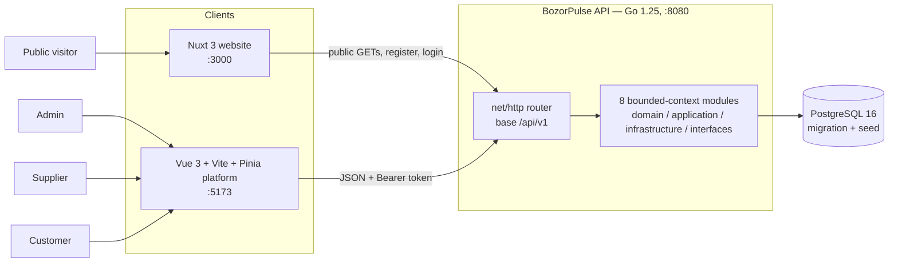
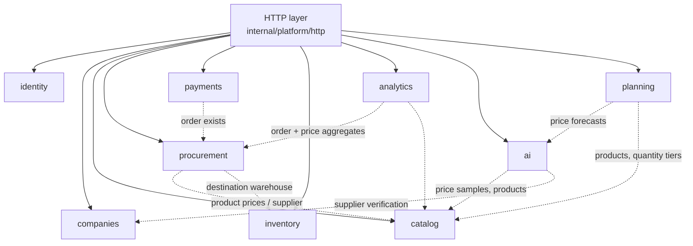
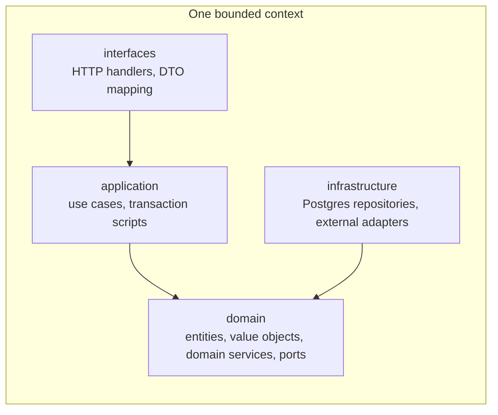
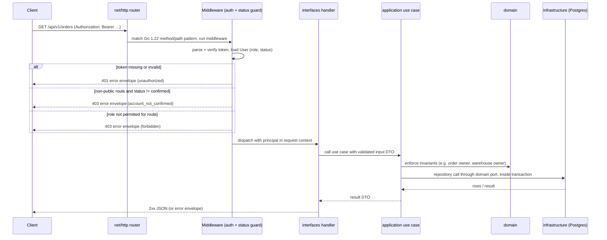
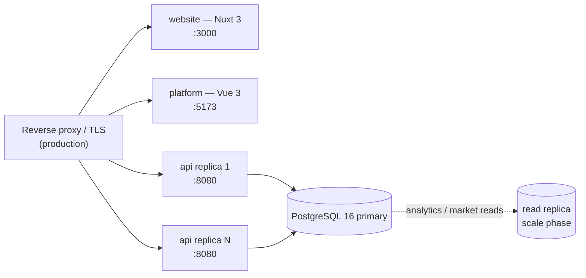

# BozorPulse — Architecture

> This document describes the architecture after the product redesign. It is part of the current specification together with [README.md](../README.md), [AI-SPECS.md](AI-SPECS.md), [DATA-MODEL.md](DATA-MODEL.md), and [ROADMAP.md](ROADMAP.md). The older `overview.md` brief is superseded.

## 1. Goals and non-goals

### Goals

- **One deployable unit, clear boundaries.** A Go 1.25 modular monolith split into bounded contexts with strict DDD layer rules, so teams can work independently without microservice overhead.
- **Trustworthy two-sided marketplace.** An approval gate, role-based access, and price visibility make it safe for a customer to create an order from a confirmed supplier.
- **Small, honest AI.** Deterministic market statistics and recommendations with labeled demo data; an assistant that only uses typed tools over real platform data.
- **Predictable operations.** PostgreSQL 16 is the single source of truth; no Redis, no message broker, and no external API keys are needed to run the MVP.
- **A path to scale.** Stateless API processes and module boundaries that allow later extraction of hot contexts without rewriting the domain.

### Non-goals (for the MVP)

- Payment processing (money movement, gateways, payouts) — payments are **records only**.
- Delivery tracking, logistics integration, or automated purchasing.
- Order execution beyond **creation** (status changes are manual, no fulfillment automation).
- Multi-tenancy, real-time chat between users, Email/SMS login, and distributed caching.
- Microservices, Kubernetes manifests, event streaming, and a production LLM dependency.

## 2. System context



**External systems in the MVP:** none required. The optional LLM hook in the `ai` module is disabled by default; when enabled it is a single outbound dependency behind an interface (see [AI-SPECS.md](AI-SPECS.md)).

## 3. Module map

```
backend/
├── cmd/api/                       # process entrypoint, composition root
├── internal/
│   ├── modules/
│   │   ├── identity/              # users, roles, auth, approval
│   │   ├── companies/             # companies, regions, verification
│   │   ├── catalog/               # categories, products, prices, discounts
│   │   ├── procurement/           # orders, order items, order status
│   │   ├── payments/              # payment records
│   │   ├── planning/              # purchase-timing plans on forecasts
│   │   ├── inventory/             # warehouses, stock, movements
│   │   ├── analytics/             # dashboards and aggregates
│   │   └── ai/                    # market stats, recommendations, assistant
│   │       └── {domain,application,infrastructure,interfaces}/
│   ├── platform/                  # auth, config, http, postgres
│   └── shared/                    # shared kernel
├── migrations/001_init.sql
└── seeds/seed.sql
```



Dotted arrows are **application-layer calls through explicit interfaces**, never direct repository or table access across modules.

### Bounded contexts and responsibilities

| Context | Owns | Key API surface | Tables (owner) |
| --- | --- | --- | --- |
| **identity** | User accounts, roles (`admin`/`supplier`/`customer`), statuses (`waiting`/`confirmed`/`rejected`), registration, login, tokens, admin approval. | `/auth/*`, `/admin/users*`, `/auth/me` | `users` |
| **companies** | Company profiles, INN/bank details, regions, supplier verification flag used by recommendations. | `/companies/me`, `/regions`, `/suppliers`, `/customers` | `companies`, `regions` |
| **catalog** | Categories, products, prices, discounts, derived `effective_price`, demo labeling of price rows. | `/categories`, `/products` | `categories`, `products`, `price_samples` (read by `ai`) |
| **procurement** | Order creation, order items, computed `total_amount`, status transitions. | `/orders` | `orders`, `order_items` |
| **payments** | Payment **records** attached to orders; no gateway calls. | `/payments` | `payments` |
| **inventory** | Multiple warehouses per owner, stock levels, supply/transfer/write-off/return movements. | `/warehouses`, `/inventory/*` | `warehouses`, `stock_items`, `inventory_movements` |
| **analytics** | Role-aware dashboard metrics, recent orders, market summary. | `/analytics/dashboard` | read-only across modules |
| **ai** | Market price statistics, deterministic supplier recommendations, rule-based assistant with typed tools and optional LLM hook. | `/market/prices`, `/ai/*` | `price_samples` (read), `recommendations` |
| **planning** | Customer-owned purchase plans with per-item price projections and conservative `buy_now`/`wait`/`monitor` signals. Reuses the AI forecaster and catalog pricing through application interfaces. | `/plans*` | `plans`, `plan_items` |

### DDD layer rules

Each module has the same four layers. Dependencies point **inward only**:



1. **Domain is pure.** It must **not** depend on `net/http`, `database/sql`, `lib/pq`, `internal/platform/postgres`, configuration, or any other module's infrastructure. It contains entities, value objects, invariants, and port interfaces (e.g. `ProductRepository`, `PriceSampleProvider`).
2. **Application orchestrates.** Use cases coordinate domain objects, call ports, and manage unit-of-work/transactions. They may call another module's **application interface**, declared in `shared` or the calling module — never another module's repository.
3. **Infrastructure implements ports.** SQL repositories, migrations, and any external client live here and are injected at the composition root (`cmd/api`).
4. **Interfaces are thin.** HTTP handlers parse JSON, enforce request shape, call one use case, and map results/errors. No business rules in handlers.
5. **Ownership is exclusive.** A table belongs to one module; other modules read it through that module's application API or a purpose-built read model. No cross-module `SELECT`.
6. **Shared kernel stays tiny.** Only cross-cutting primitives (IDs, money type, error envelope, enum definitions) go in `internal/shared`. If a concept starts carrying business rules, it moves into a domain.

### Request flow (auth + status guard)



**Public endpoints** bypass the token check: `POST /auth/register`, `POST /auth/login`, and `GET /products`, `/categories`, `/regions`, `/suppliers`, `/market/prices`. Every other route requires a valid token; admin routes additionally require `role = admin`. The status guard rejects `waiting`/`rejected` users with `403 account_not_confirmed` even if their token is valid — this is the technical enforcement of the approval workflow.

## 4. Role-based authorization

| Endpoint group | Public | admin | supplier | customer |
| --- | :---: | :---: | :---: | :---: |
| `POST /auth/register`, `POST /auth/login` | ✅ | ✅ | ✅ | ✅ |
| `GET /auth/me` | — | ✅ | ✅ | ✅ |
| `POST /admin/users/{id}/approve\|reject`, `GET /admin/users` | — | ✅ | — | — |
| `GET /categories`, `/regions`, `/products`, `/suppliers`, `/market/prices` | ✅ | ✅ | ✅ | ✅ |
| `POST/PATCH/DELETE /categories`, `/products`, `POST /products/{id}/discount` | — | ✅ | ✅ (own products) | — |
| `GET /customers` | — | ✅ | ✅ | — |
| `GET/PATCH /companies/me` | — | ✅ | ✅ | ✅ |
| `GET/POST /warehouses`, `GET/PATCH/DELETE /warehouses/{id}` | — | — | ✅ (own) | ✅ (own) |
| `GET/POST /orders`, `GET /orders/{id}` | — | ✅ | ✅ (own as supplier) | ✅ (own as customer) |
| `PATCH /orders/{id}/status` | — | ✅ | ✅ | — |
| `GET/POST /payments`, `GET /payments/{id}` | — | ✅ | ✅ (own) | ✅ (own) |
| `GET /inventory/stock`, `GET /inventory/movements`, `POST /inventory/*` | — | — | ✅ (own warehouses) | ✅ (own warehouses) |
| `GET /analytics/dashboard` | — | ✅ | ✅ | ✅ (shape varies by `role`) |
| `GET/POST /plans`, `GET/PATCH/DELETE /plans/{id}`, `POST /plans/{id}/refresh`, `POST /plans/preview` | — | — | — | ✅ (own company only) |
| `GET /ai/recommendations`, `POST /ai/chat` | — | ✅ | ✅ | ✅ |

Authorization is enforced in two places: **middleware** checks token + global role, and **use cases** check object-level ownership (a supplier may only edit their own products; a customer may only order from their own warehouse). Ownership failures return `403`, not `404`, when the object exists but belongs to someone else; nonexistent objects return `404`.

## 5. Error handling

All non-2xx responses use one JSON envelope:

```json
{
  "error": {
    "code": "account_not_confirmed",
    "message": "Account is awaiting admin approval.",
    "details": { "status": "waiting" },
    "request_id": "b7f1…"
  }
}
```

| HTTP | `code` | When |
| --- | --- | --- |
| 400 | `bad_request` | Malformed JSON, invalid path/query parameters. |
| 401 | `unauthorized` | Missing, expired, or invalid Bearer token. |
| 403 | `forbidden` | Role not allowed for the route. |
| 403 | `account_not_confirmed` | Valid token but `status != confirmed`. |
| 404 | `not_found` | Resource does not exist. |
| 409 | `conflict` | Duplicate username/SKU, invalid state transition (e.g. `delivered → new`). |
| 422 | `validation_failed` | Valid JSON but business validation failed (e.g. negative quantity, unknown `region_id`). |
| 500 | `internal_error` | Unexpected failure; `details` omitted in production, logged with `request_id`. |

Handlers never leak SQL errors or stack traces. `APP_ENV=development` may add debug detail; production returns the generic envelope. A `request_id` (generated in middleware) is echoed in the `X-Request-ID` header and included in logs for correlation.

## 6. Deployment topology



- **Local/dev:** `docker compose up --build` starts `postgres`, `api`, `platform`, `website`, and `prototype`. On first init PostgreSQL applies `backend/migrations/001_init.sql` and `backend/seeds/seed.sql` via `docker-entrypoint-initdb.d`.
- **API process:** stateless; all state is in PostgreSQL. Tokens are signed with `JWT_SECRET`, so any replica can validate them — no shared session store.
- **Config:** injected via environment variables (`DATABASE_URL`, `BP_ADDR`, `APP_ENV`, `JWT_SECRET`, `TOKEN_TTL`, `CORS_ORIGIN`, `LOG_LEVEL`). See [README.md](../README.md#environment-variables).
- **Health:** `GET /health` returns `{"status":"ok","service":"bozorpulse"}`; Postgres readiness is checked before the API starts in Compose.
- **Production:** terminate TLS at a reverse proxy, set `APP_ENV=production` and a strong `JWT_SECRET`, run migrations as a deployment step (not on every API start), and ship logs centrally with `request_id`.

## 7. Scaling path

1. **Vertical first.** Tune Postgres indexes from `DATA-MODEL.md`, connection pool sizing, and `EXPLAIN ANALYZE` on `/market/prices` and `/analytics/dashboard` queries.
2. **Stateless replicas.** Run multiple API processes behind a load balancer; no in-memory session state to synchronize.
3. **Read replica.** Route analytics, market statistics, and directory reads to a replica; keep order/approval writes on the primary.
4. **Precompute hot reads.** Materialize market statistics and recommendation inputs per category on a schedule (a table or refresh job), still labeled by `data_status`. This is the first place a cache could be introduced — deliberately absent in the MVP ([ADR-003](#adr-003-no-redis-in-the-mvp)).
5. **Partition and archive.** Partition `inventory_movements`, `price_samples`, and `payments` by time; archive old orders.
6. **Extract contexts.** If one bounded context becomes a bottleneck, it can be split into a service behind the same application interface; the domain code moves unchanged. `ai` and `analytics` are the most likely first candidates.
7. **Async work.** Introduce an outbox/worker only when a real asynchronous need appears (e.g. precomputing recommendations) — not for MVP order creation.

## 8. Architecture decision records

### ADR-001: Modular monolith

- **Context:** Eight bounded contexts must be delivered by a small team; microservice overhead (deployments, networking, distributed transactions) would dominate MVP work.
- **Decision:** One Go binary with compile-time-enforced module boundaries (`internal/modules/<context>`), each with four DDD layers. Cross-context calls go through application interfaces.
- **Consequences:** Simple local development, one database, transactional consistency between order/payment/inventory writes. Teams must enforce boundaries through code review and import linting; later extraction is possible along the same seams.

### ADR-002: Standard-library HTTP router

- **Context:** Go 1.25 is available; routing needs method + path parameters (`/api/v1/products/{id}`).
- **Decision:** Use `net/http.ServeMux` with Go 1.22+ patterns ("GET /api/v1/products/{id}") plus small middleware for auth, status guard, logging, recovery, and error encoding. No third-party router/framework.
- **Consequences:** Minimal dependencies and predictable behavior. Advanced features (automatic OpenAPI, path constraints) are not provided; when needed, add thin helpers rather than a framework.

### ADR-003: No Redis in the MVP

- **Context:** Market statistics and recommendations are small aggregate queries; demo data volume is low.
- **Decision:** Compute on demand from PostgreSQL; do not run a cache or include Redis in the documented stack.
- **Consequences:** One less service to operate and no cache-invalidation bugs. Under load, queries must be optimized and reads moved to a replica or precomputed ([Scaling path](#7-scaling-path)) before introducing a cache.

### ADR-004: Token sessions

- **Context:** Login is username + password only; browser clients (platform/website) and curl clients both need authenticated access.
- **Decision:** Issue a signed bearer token from `/auth/register` and `/auth/login`, validated statelessly by middleware (`JWT_SECRET`, `TOKEN_TTL`). `POST /auth/register` also returns a token, but the status guard blocks cabinet access until approval.
- **Consequences:** No session table or shared store; replicas are interchangeable. Tokens cannot be individually revoked before expiry in the MVP — add a short TTL and, later, a denylist if revocation becomes a requirement.

### ADR-005: Admin approval gate

- **Context:** A two-sided marketplace with company/INN/bank data needs trust; self-service access for unverified accounts is risky.
- **Decision:** New accounts start `waiting`; admin approves/rejects from the Suppliers/Customers lists. Only `confirmed` users may access cabinets and write operations; the rule is enforced centrally in middleware (status guard) and rechecked in use cases.
- **Consequences:** Clean, auditable onboarding and simple client behavior (one 403 code with `status`). Requires admin availability; resubmission/rejection flows and audit history are follow-up work.
