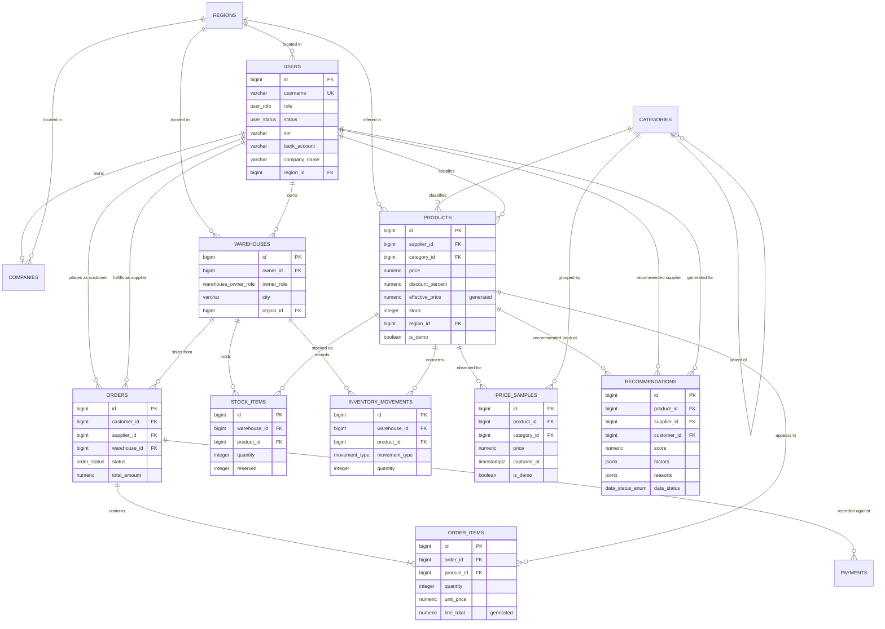

# BozorPulse — Data Model

> Part of the current spec. See [README.md](../README.md), [ARCHITECTURE.md](ARCHITECTURE.md), [AI-SPECS.md](AI-SPECS.md), and [ROADMAP.md](ROADMAP.md). The legacy `overview.md` brief is superseded.

## Conventions

- **PostgreSQL 16** is the single source of truth. Schema: `backend/migrations/001_init.sql`; demo data: `backend/seeds/seed.sql`.
- Primary keys are `BIGINT GENERATED ALWAYS AS IDENTITY` (so `/api/v1/admin/users/4/approve`-style URLs are readable). Foreign keys reuse `BIGINT`.
- All timestamps are `TIMESTAMPTZ`, stored in UTC and rendered in the client's locale.
- Money is `NUMERIC(14,2)`; percentages are `NUMERIC(5,2)` (0–100). Never use `FLOAT` for prices.
- `is_demo = true` marks seeded/synthetic rows. These must be labeled in API and UI ([AI-SPECS.md §4](AI-SPECS.md#4-demo-data-labeling-rules)).
- Each table is **owned by one bounded context** (see [ARCHITECTURE.md §3](ARCHITECTURE.md#3-module-map)). Other modules read it through that module's application API, not by direct SQL.
- `updated_at` is maintained by the owning application service (or a trigger); the DDL shows `DEFAULT now()` only.
- **Authority note:** the SQL files in `backend/migrations/` are authoritative for the deployed schema. The legacy overview behind this document assumed `BIGINT` ids and user-owned rows; the actual migrations use `TEXT` ids and company-scoped ownership. Section 8 follows the deployed convention.

## 1. Enums

```sql
CREATE TYPE user_role           AS ENUM ('admin', 'supplier', 'customer');
CREATE TYPE user_status         AS ENUM ('waiting', 'confirmed', 'rejected');
CREATE TYPE warehouse_owner_role AS ENUM ('supplier', 'customer');
CREATE TYPE order_status        AS ENUM ('new', 'confirmed', 'processing', 'shipped', 'delivered', 'cancelled');
CREATE TYPE payment_method      AS ENUM ('bank_transfer', 'cash', 'card', 'other');
CREATE TYPE payment_status      AS ENUM ('pending', 'succeeded', 'failed', 'refunded');
CREATE TYPE movement_type       AS ENUM ('supply', 'transfer', 'write_off', 'return');
CREATE TYPE data_status_enum    AS ENUM ('demo', 'live', 'insufficient');
```

## 2. Schema (DDL)

```sql
-- ── regions & categories ────────────────────────────────────────────────
CREATE TABLE regions (
    id          BIGINT GENERATED ALWAYS AS IDENTITY PRIMARY KEY,
    name        VARCHAR(128) NOT NULL UNIQUE,
    code        VARCHAR(16),
    parent_id   BIGINT REFERENCES regions(id) ON DELETE SET NULL,
    created_at  TIMESTAMPTZ NOT NULL DEFAULT now()
);

CREATE TABLE categories (
    id          BIGINT GENERATED ALWAYS AS IDENTITY PRIMARY KEY,
    name        VARCHAR(128) NOT NULL,
    slug        VARCHAR(128) NOT NULL UNIQUE,
    parent_id   BIGINT REFERENCES categories(id) ON DELETE SET NULL,
    created_at  TIMESTAMPTZ NOT NULL DEFAULT now()
);

-- ── identity & companies ────────────────────────────────────────────────
CREATE TABLE users (
    id              BIGINT GENERATED ALWAYS AS IDENTITY PRIMARY KEY,
    username        VARCHAR(64)  NOT NULL UNIQUE,
    password_hash   TEXT         NOT NULL,
    role            user_role    NOT NULL,
    status          user_status  NOT NULL DEFAULT 'waiting',
    inn             VARCHAR(20)  NOT NULL,
    bank_account    VARCHAR(64)  NOT NULL,
    company_name    VARCHAR(255) NOT NULL,
    region_id       BIGINT REFERENCES regions(id) ON DELETE SET NULL,
    phone           VARCHAR(32),
    created_at      TIMESTAMPTZ  NOT NULL DEFAULT now(),
    updated_at      TIMESTAMPTZ  NOT NULL DEFAULT now()
);

CREATE TABLE companies (
    id           BIGINT GENERATED ALWAYS AS IDENTITY PRIMARY KEY,
    owner_user_id BIGINT NOT NULL UNIQUE REFERENCES users(id) ON DELETE CASCADE,
    name         VARCHAR(255) NOT NULL,
    inn          VARCHAR(20)  NOT NULL,
    bank_account VARCHAR(64)  NOT NULL,
    region_id    BIGINT REFERENCES regions(id) ON DELETE SET NULL,
    verified     BOOLEAN NOT NULL DEFAULT false,
    created_at   TIMESTAMPTZ NOT NULL DEFAULT now(),
    updated_at   TIMESTAMPTZ NOT NULL DEFAULT now()
);

-- ── catalog ─────────────────────────────────────────────────────────────
CREATE TABLE products (
    id                BIGINT GENERATED ALWAYS AS IDENTITY PRIMARY KEY,
    supplier_id       BIGINT NOT NULL REFERENCES users(id) ON DELETE RESTRICT,
    category_id       BIGINT NOT NULL REFERENCES categories(id) ON DELETE RESTRICT,
    name              VARCHAR(255) NOT NULL,
    sku               VARCHAR(64)  NOT NULL UNIQUE,
    description       TEXT,
    unit              VARCHAR(16)  NOT NULL DEFAULT 'pcs',
    price             NUMERIC(14,2) NOT NULL CHECK (price >= 0),
    discount_percent  NUMERIC(5,2)  NOT NULL DEFAULT 0 CHECK (discount_percent BETWEEN 0 AND 100),
    effective_price   NUMERIC(14,2) GENERATED ALWAYS AS
                        (round(price * (1 - discount_percent / 100), 2)) STORED,
    stock             INTEGER NOT NULL DEFAULT 0 CHECK (stock >= 0),
    region_id         BIGINT REFERENCES regions(id) ON DELETE SET NULL,
    is_demo           BOOLEAN NOT NULL DEFAULT false,
    created_at        TIMESTAMPTZ NOT NULL DEFAULT now(),
    updated_at        TIMESTAMPTZ NOT NULL DEFAULT now()
);

-- ── inventory ───────────────────────────────────────────────────────────
CREATE TABLE warehouses (
    id          BIGINT GENERATED ALWAYS AS IDENTITY PRIMARY KEY,
    owner_id    BIGINT NOT NULL REFERENCES users(id) ON DELETE CASCADE,
    owner_role  warehouse_owner_role NOT NULL,
    name        VARCHAR(255) NOT NULL,
    address     VARCHAR(512),
    city        VARCHAR(128),
    region_id   BIGINT REFERENCES regions(id) ON DELETE SET NULL,
    latitude    NUMERIC(9,6) CHECK (latitude BETWEEN -90 AND 90),
    longitude   NUMERIC(9,6) CHECK (longitude BETWEEN -180 AND 180),
    created_at  TIMESTAMPTZ NOT NULL DEFAULT now()
);

CREATE TABLE stock_items (
    id            BIGINT GENERATED ALWAYS AS IDENTITY PRIMARY KEY,
    warehouse_id  BIGINT NOT NULL REFERENCES warehouses(id) ON DELETE CASCADE,
    product_id    BIGINT NOT NULL REFERENCES products(id) ON DELETE RESTRICT,
    quantity      INTEGER NOT NULL DEFAULT 0 CHECK (quantity >= 0),
    reserved      INTEGER NOT NULL DEFAULT 0 CHECK (reserved >= 0),
    updated_at    TIMESTAMPTZ NOT NULL DEFAULT now(),
    UNIQUE (warehouse_id, product_id)
);

CREATE TABLE inventory_movements (
    id                 BIGINT GENERATED ALWAYS AS IDENTITY PRIMARY KEY,
    warehouse_id       BIGINT NOT NULL REFERENCES warehouses(id) ON DELETE RESTRICT,
    product_id         BIGINT NOT NULL REFERENCES products(id) ON DELETE RESTRICT,
    movement_type      movement_type NOT NULL,
    quantity           INTEGER NOT NULL CHECK (quantity <> 0),
    from_warehouse_id  BIGINT REFERENCES warehouses(id) ON DELETE SET NULL,
    to_warehouse_id    BIGINT REFERENCES warehouses(id) ON DELETE SET NULL,
    reference_id       BIGINT,           -- order_id / payment_id / manual ref, when applicable
    note               TEXT,
    actor_id           BIGINT REFERENCES users(id) ON DELETE SET NULL,
    created_at         TIMESTAMPTZ NOT NULL DEFAULT now(),
    CHECK (movement_type <> 'transfer' OR (from_warehouse_id IS NOT NULL AND to_warehouse_id IS NOT NULL))
);

-- ── procurement ─────────────────────────────────────────────────────────
CREATE TABLE orders (
    id            BIGINT GENERATED ALWAYS AS IDENTITY PRIMARY KEY,
    customer_id   BIGINT NOT NULL REFERENCES users(id) ON DELETE RESTRICT,
    supplier_id   BIGINT NOT NULL REFERENCES users(id) ON DELETE RESTRICT,
    warehouse_id  BIGINT NOT NULL REFERENCES warehouses(id) ON DELETE RESTRICT,
    status        order_status NOT NULL DEFAULT 'new',
    total_amount  NUMERIC(14,2) NOT NULL DEFAULT 0 CHECK (total_amount >= 0),
    created_at    TIMESTAMPTZ NOT NULL DEFAULT now(),
    updated_at    TIMESTAMPTZ NOT NULL DEFAULT now()
);

CREATE TABLE order_items (
    id                BIGINT GENERATED ALWAYS AS IDENTITY PRIMARY KEY,
    order_id          BIGINT NOT NULL REFERENCES orders(id) ON DELETE CASCADE,
    product_id        BIGINT NOT NULL REFERENCES products(id) ON DELETE RESTRICT,
    quantity          INTEGER NOT NULL CHECK (quantity > 0),
    unit_price        NUMERIC(14,2) NOT NULL CHECK (unit_price >= 0),
    discount_percent  NUMERIC(5,2) NOT NULL DEFAULT 0 CHECK (discount_percent BETWEEN 0 AND 100),
    line_total        NUMERIC(14,2) GENERATED ALWAYS AS
                        (round(unit_price * quantity * (1 - discount_percent / 100), 2)) STORED,
    created_at        TIMESTAMPTZ NOT NULL DEFAULT now(),
    UNIQUE (order_id, product_id)
);

-- ── payments (records only — no money movement) ─────────────────────────
CREATE TABLE payments (
    id            BIGINT GENERATED ALWAYS AS IDENTITY PRIMARY KEY,
    order_id      BIGINT NOT NULL REFERENCES orders(id) ON DELETE RESTRICT,
    amount        NUMERIC(14,2) NOT NULL CHECK (amount >= 0),
    method        payment_method NOT NULL DEFAULT 'bank_transfer',
    bank_account  VARCHAR(64) NOT NULL,
    status        payment_status NOT NULL DEFAULT 'pending',
    created_at    TIMESTAMPTZ NOT NULL DEFAULT now()
);

-- ── AI support tables ───────────────────────────────────────────────────
CREATE TABLE price_samples (
    id          BIGINT GENERATED ALWAYS AS IDENTITY PRIMARY KEY,
    product_id  BIGINT NOT NULL REFERENCES products(id) ON DELETE CASCADE,
    category_id BIGINT NOT NULL REFERENCES categories(id) ON DELETE RESTRICT,
    price       NUMERIC(14,2) NOT NULL CHECK (price > 0),
    source      VARCHAR(64) NOT NULL DEFAULT 'seed',
    captured_at TIMESTAMPTZ NOT NULL DEFAULT now(),
    is_demo     BOOLEAN NOT NULL DEFAULT true,
    created_at  TIMESTAMPTZ NOT NULL DEFAULT now()
);

CREATE TABLE recommendations (
    id          BIGINT GENERATED ALWAYS AS IDENTITY PRIMARY KEY,
    product_id  BIGINT NOT NULL REFERENCES products(id) ON DELETE CASCADE,
    supplier_id BIGINT NOT NULL REFERENCES users(id) ON DELETE CASCADE,
    customer_id BIGINT REFERENCES users(id) ON DELETE SET NULL,
    score       NUMERIC(6,3) NOT NULL CHECK (score BETWEEN 0 AND 100),
    factors     JSONB NOT NULL,   -- {price, freshness, region, verification} in [0,1]
    reasons     JSONB NOT NULL,   -- array of localized reason strings/template keys
    data_status data_status_enum NOT NULL DEFAULT 'demo',
    is_demo     BOOLEAN NOT NULL DEFAULT true,
    created_at  TIMESTAMPTZ NOT NULL DEFAULT now()
);
```

## 3. Table reference

| Table | Owner context | Purpose | Notable columns |
| --- | --- | --- | --- |
| `users` | identity | Accounts, roles, approval status, login credentials, company fields from registration. | `username UNIQUE`, `password_hash`, `role`, `status`, `inn`, `bank_account`, `company_name` |
| `companies` | companies | Extended company profile and the `verified` flag used by recommendations. | `owner_user_id UNIQUE`, `verified`, `inn`, `bank_account` |
| `regions` | companies | Geographic tree used by warehouses, products, users, recommendations. | `parent_id` (self-reference), `code` |
| `categories` | catalog | Product category tree used by catalog and market stats. | `slug UNIQUE`, `parent_id` |
| `products` | catalog | Supplier product listings with prices and discounts. | `supplier_id`, `category_id`, `effective_price` (generated), `stock`, `is_demo` |
| `warehouses` | inventory | Multiple locations per supplier/customer; customer picks one when ordering. | `owner_id`, `owner_role`, `latitude`, `longitude` |
| `orders` | procurement | Order header created on the platform. | `customer_id`, `supplier_id`, `warehouse_id`, `status`, `total_amount` |
| `order_items` | procurement | Lines of an order; snapshots price/discount at order time. | `quantity`, `unit_price`, `line_total` (generated) |
| `payments` | payments | Payment **records** attached to orders; no gateway integration. | `order_id`, `method`, `bank_account`, `status` |
| `stock_items` | inventory | Per-warehouse, per-product stock with reservations. | `UNIQUE(warehouse_id, product_id)`, `quantity`, `reserved` |
| `inventory_movements` | inventory | Audit trail for supplies, transfers, write-offs, returns. | `movement_type`, signed `quantity`, transfer warehouse pair |
| `price_samples` | catalog (read by ai) | Observed/seed prices powering `/market/prices` and recommendations. | `price`, `captured_at`, `source`, `is_demo` |
| `recommendations` | ai | Persisted scored recommendations with factors/reasons for audit. | `score`, `factors`, `reasons`, `data_status`, `is_demo` |

### Derived values

- `products.effective_price = round(price × (1 − discount_percent / 100), 2)` — a **generated stored column**, always consistent with the API's `Product.effective_price`.
- `order_items.line_total = round(unit_price × quantity × (1 − discount_percent / 100), 2)` — generated stored column.
- `orders.total_amount` is **maintained by the procurement application service** in the same transaction as the order items (a generated column cannot aggregate across rows). Recompute from `SUM(line_total)` after any item change.
- `stock_items.quantity` is updated by inventory movements; the movement rows are the immutable audit trail.

## 4. Relationships and ER diagram



### Relationship notes

- `users → companies` is **1:1** (`companies.owner_user_id UNIQUE`). `users.company_name` is a denormalized copy for the `User` API shape; the `companies` row is the editable profile via `GET/PATCH /companies/me`.
- `users → orders` has **two** relationships: as `customer_id` (the customer) and as `supplier_id` (the seller). Both are required on an order.
- `warehouses → orders` records **which warehouse the customer selected at order time**; it need not belong to the supplier.
- `inventory_movements.from_warehouse_id` / `to_warehouse_id` are only required for `movement_type = 'transfer'`.
- `price_samples.category_id` is intentionally denormalized from `products.category_id` so `/market/prices` can filter by category without joining products; the application writes both consistently.

## 5. Indexes

```sql
CREATE INDEX idx_users_role_status            ON users (role, status);
CREATE INDEX idx_companies_region             ON companies (region_id);
CREATE INDEX idx_regions_parent               ON regions (parent_id);
CREATE INDEX idx_categories_parent            ON categories (parent_id);

CREATE INDEX idx_products_supplier            ON products (supplier_id);
CREATE INDEX idx_products_category            ON products (category_id);
CREATE INDEX idx_products_region              ON products (region_id);
CREATE INDEX idx_products_name_lower          ON products (lower(name));
CREATE INDEX idx_products_category_price      ON products (category_id, effective_price);

CREATE INDEX idx_warehouses_owner             ON warehouses (owner_id, owner_role);
CREATE INDEX idx_warehouses_region            ON warehouses (region_id);
-- UNIQUE(warehouse_id, product_id) already indexes stock_items by warehouse.
CREATE INDEX idx_stock_items_product          ON stock_items (product_id);
CREATE INDEX idx_movements_warehouse_created   ON inventory_movements (warehouse_id, created_at DESC);
CREATE INDEX idx_movements_product            ON inventory_movements (product_id);
CREATE INDEX idx_movements_type               ON inventory_movements (movement_type, created_at DESC);

CREATE INDEX idx_orders_customer              ON orders (customer_id, created_at DESC);
CREATE INDEX idx_orders_supplier              ON orders (supplier_id, created_at DESC);
CREATE INDEX idx_orders_warehouse             ON orders (warehouse_id);
CREATE INDEX idx_orders_status                ON orders (status, created_at DESC);
CREATE INDEX idx_order_items_product          ON order_items (product_id);

CREATE INDEX idx_payments_order               ON payments (order_id);
CREATE INDEX idx_payments_status              ON payments (status, created_at DESC);

CREATE INDEX idx_price_samples_category_time  ON price_samples (category_id, captured_at DESC);
CREATE INDEX idx_price_samples_product_time   ON price_samples (product_id, captured_at DESC);
CREATE INDEX idx_price_samples_demo           ON price_samples (is_demo);

CREATE INDEX idx_recommendations_product_score ON recommendations (product_id, score DESC);
CREATE INDEX idx_recommendations_customer_time ON recommendations (customer_id, created_at DESC);
CREATE INDEX idx_recommendations_status       ON recommendations (data_status);
```

`UNIQUE` constraints (`users.username`, `products.sku`, `categories.slug`, `companies.owner_user_id`, `stock_items(warehouse_id, product_id)`, `order_items(order_id, product_id)`) create their own indexes and are not duplicated above. For substring search (`q` on name/SKU), a `pg_trgm` GIN index is a Phase-3 optimization, not an MVP dependency.

## 6. Status enums and transitions

| Enum | Values | Allowed transitions |
| --- | --- | --- |
| `user_role` | `admin`, `supplier`, `customer` | Fixed at registration; admins do not change roles in the MVP. |
| `user_status` | `waiting`, `confirmed`, `rejected` | `waiting → confirmed` (approve), `waiting → rejected` (reject), `rejected → waiting` (resubmit). Only `confirmed` users access cabinets. |
| `order_status` | `new`, `confirmed`, `processing`, `shipped`, `delivered`, `cancelled` | `new → confirmed → processing → shipped → delivered`; `new`/`confirmed` → `cancelled`. No backward transitions. Admin may set valid forward states via `PATCH /orders/{id}/status`; supplier may confirm/process/ship. |
| `payment_method` | `bank_transfer`, `cash`, `card`, `other` | No transitions (record field). |
| `payment_status` | `pending`, `succeeded`, `failed`, `refunded` | `pending → succeeded` / `failed`; `succeeded → refunded`. Records only — no gateway call. |
| `movement_type` | `supply`, `transfer`, `write_off`, `return` | No transitions. API paths: `POST /inventory/supplies`, `/transfers`, `/write-offs`, `/returns` map to `supply`, `transfer`, `write_off`, `return`. |
| `data_status` | `demo`, `live`, `insufficient` | Computed per response; see [AI-SPECS.md §1.4](AI-SPECS.md#14-data_status-decision). |
| `warehouse_owner_role` | `supplier`, `customer` | Fixed when the warehouse is created; must match the owner's role. |

## 7. Data integrity and lifecycle notes

- **Ordering:** create order → create `order_items` → recompute `total_amount` in one transaction. Ownership checks (`customer_id` = caller, `warehouse_id` belongs to caller) happen in the procurement use case before insert.
- **Stock:** `stock_items` is updated transactionally with `inventory_movements`; negative resulting `quantity` is rejected by the CHECK constraint and the use case.
- **Approval:** approving a user flips `users.status` to `confirmed`; the change is immediately visible to the status guard because tokens carry the user ID, not a cached status.
- **AI data:** `price_samples` and `recommendations` retain `is_demo` and `data_status` so every statistic can be traced and labeled. Recommendations are snapshots; they are not recomputed in place.
- **Deletion:** `orders` and `payments` use `RESTRICT` on user/product references to preserve history; user deletion is therefore a soft/archival operation in practice. `companies` and `warehouses` cascade from their owner; `order_items` cascade from their order.

## 8. Planning tables (migration `007_planning.sql`)

Owner context: `planning`. These tables follow the deployed TEXT-id, company-owned convention. Full DDL lives in `backend/migrations/007_planning.sql`.

| Table | Purpose | Notable columns |
| --- | --- | --- |
| `plans` | Customer purchase-timing plan header. | `company_id` (owner, FK companies), `customer_id` (FK users), `title`, `region_id`, `status` (`draft`/`active`/`archived`) |
| `plan_items` | One planned product need plus a forecast snapshot. | `plan_id` (FK, cascade), `product_id` (FK), `quantity > 0`, `target_date`, `current_unit_price`, `predicted`, `low`, `high`, `change_pct`, `estimated_budget`, `budget_low/high`, `saving_vs_now`, `recommendation` (`buy_now`/`wait`/`monitor`/`insufficient`), `reason`, `data_status`, `basis`, `projection_note`, `generated_at` |

- Projection numeric columns are **nullable**: when the underlying forecast is `insufficient`, the API returns `null` rather than a fabricated `0`.
- `recommendation` is computed by a pure domain rule; the LLM never writes it.
- `UNIQUE(plan_id, product_id)` prevents duplicate lines; `idx_plans_owner(company_id, updated_at DESC)` and `idx_plan_items_plan(plan_id)` support the list/detail paths.
- Ownership is enforced both in the use case and in repository queries (`WHERE company_id = <principal>`); cross-company access returns `403`.
